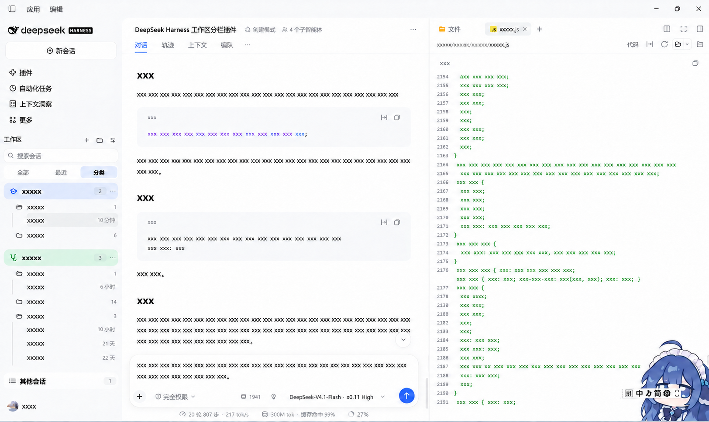

# dsh-workspace-categories

**English** · [简体中文](README.zh-CN.md)

Group the **DeepSeek Harness** desktop sidebar's workspaces into custom
categories. A category is a compact tinted row that holds its own workspaces and
their sessions, and you file things by pressing and holding a title and dragging
it where you want it.

[](LICENSE)




## Requirements

- DeepSeek Harness **desktop** `>= 0.2.0-rc.2`. Developed and verified against
  `0.2.2-rc.3`.
- No build step, no network access, no extra dependencies. The plugin is plain
  JavaScript and a manifest.

## Install

The plugin is a local **bundle**: DSH links the directory into the active profile
rather than copying it.

### From the Plugins page (recommended)

1. Get the files. Either `git clone https://github.com/Znk1314/dsh-workspace-categories.git`
   or use the repository's **Code → Download ZIP** and extract it.
2. In DSH open **Settings → Plugins → Add plugin**.
3. Select the **repository directory** — the folder that contains
   `package.json` and `cordis.patch.yml`, not a parent folder and not a file.
4. The entry **Workspace categories** appears in the plugin list. Make sure it is
   enabled; the sidebar updates immediately.

### Verify it loaded

Open the sidebar. You should see the *Workspaces* header with **All / Recent /
Categories** tabs under the search box, and the **＋** button beside the header
creates your first category.

If the sidebar looks unchanged, the plugin did not activate. Check
**Settings → Plugins** that the entry is present and enabled, then reload the
window. A plugin that throws while rendering silently falls back to the built-in
sidebar, so an enabled-but-broken plugin looks identical to a disabled one.

### Updating

After replacing `client.js` (or pulling a new version), **remove and re-add** the
plugin. A local install is a link, and DSH does not hot-swap an already loaded
client module. Your categories live on the Host, so they survive the reinstall.

### Uninstalling

Remove the plugin in **Settings → Plugins**. Your data stays at
`<DSH_HOME>/plugin-data/dsh-workspace-categories/categories.json`; delete that
file to remove it too. No session, workspace, or message is ever deleted by this
plugin.

## Features

- **Rounded tinted category rows** — the category's own row is one rounded rectangle filled with a light tint of its accent, carrying its icon, name, and count; its workspaces and sessions hang below on the plain sidebar surface, joined by an indent guide.
- **Three filters** — *All* (one flat session list), *Recent* (recently used workspaces), and *Categories* (your groupings). The selected filter is a tinted pill.
- **Fold by icon** — click a category's icon to collapse the category, or a workspace's folder to collapse just that workspace (closed folder while folded, open folder while shown).
- **Live status** — a running session shows a spinner where its timestamp normally sits.
- **Long-press drag** — hold a workspace title for a moment and drag it into any category.
- **Free re-ordering** — drag with the same gesture to change a workspace's position inside a category.
- **Category ordering and pinning** — drag a category row, or use Move up / Move down; pinned categories always render first.
- **Pick an icon and a colour** — 30 line glyphs and 9 swatches per category, chosen from one picker that previews the change live. The colour tints the category row and its glyph; text stays in the theme ink.
- **Nothing disappears** — workspaces with no category fall into an *Unassigned* entry at the foot of the list, and sessions with no workspace into an *Other sessions* entry.
- **Keeps built-in power features** — search (auto-expands folded categories), archived-row filtering, add/rename/delete workspace, and the full right-click session menu.
- **Durable** — categories are stored on the Host, not in browser storage, so they survive restarts and port changes.

## Usage

| Action | How |
|---|---|
| Create a category | the **＋** beside the sidebar's *Workspaces* title |
| File a workspace | **press and hold** its title, then drag into a box — or use its **⋯** menu → *Move to category* |
| Re-order inside a box | press and hold, then drop on the upper/lower half of another workspace row; the box tail shows an insertion line |
| Re-order categories | press and hold a category header, or its **⋯** menu → *Move up* / *Move down* |
| Pin a category | category **⋯** menu → *Pin category* (pinned boxes stay on top) |
| Change icon or colour | category **⋯** menu → *Icon and colour*, then pick a glyph and a swatch |
| Collapse / expand a category | click the category's icon; expand shows it open, collapse hides its workspaces |
| Collapse / expand one workspace | click its folder icon (open folder = expanded, closed = folded), or its **⋯** menu → *Collapse workspace* |
| Remove a workspace from a category | drag it into *Unassigned*, or its **⋯** menu → *Remove from category* |
| Delete a category | category **⋯** menu → *Delete category* (its workspaces return to *Unassigned*; no session is deleted) |
| Switch view | the **All / Recent / Categories** tabs under the search box |
| Archived filter | the sliders button at the right |

Every drag-only action also has a menu path, so a keyboard or touch user can do
all of it.

### Gesture details

- Dragging starts after a **180 ms** hold; moving more than 6 px first is treated
  as a scroll or a click instead.
- Press `Esc` mid-drag to cancel. Losing window focus or a cancelled pointer also
  ends the drag cleanly — no stuck ghost, no locked text selection.
- Dropping into the gap between boxes, or into empty space, is **not** a valid
  target and changes nothing. Only the *Unassigned* box unfiles a workspace.
- Dropping a row onto itself does nothing rather than jumping to the end.
- Pinned and unpinned categories never interleave; a cross-group drop is refused
  instead of silently discarded.

## Data

Categories live in one JSON document, served by the Host half over an
authenticated route (`/api/workspace-categories.doc`; only the owner peer may
reach it):

```text
<DSH_HOME>/plugin-data/dsh-workspace-categories/categories.json
```

Writes are debounced 240 ms and serialised through a temporary file plus rename.
A failed save shows a notice in the panel and is retried every 5 seconds; the
notice clears once a write succeeds.

```json
{
  "version": 1,
  "categories": [
    { "id": "c1", "name": "Client work", "color": "blue", "icon": "briefcase",
      "pinned": true, "collapsed": false, "workspaceIds": ["w1", "w2"] }
  ],
  "view": { "tab": "categories", "archived": "default" },
  "unassignedCollapsed": false,
  "collapsedWorkspaces": ["w3"]
}
```

`color` accepts `ink | red | orange | amber | green | blue | violet | pink | slate`;
`view.tab` accepts `categories | recent | all`; `view.archived` accepts
`default | show | only`; `collapsedWorkspaces` lists folded workspace ids; `icon` names one of the 30 built-in glyphs
(`folder`, `book`, `graduation`, `briefcase`, `terminal`, `palette`, `brain`, `plant`, …) and falls back to `folder`.
The Host repairs malformed or hostile input, so a
damaged file never takes the sidebar down.

## How it works

- `sidebar.workspaces` is a `single` slot. This plugin registers into it with
  `priority: -1000`; the slot keeps the lowest priority, so it **replaces** the
  shipped browser instead of sitting beside it.
- The sidebar's scroll region declares `container-type`, which makes
  `position: fixed` resolve against the sidebar. Menus, dialogs, and the drag
  ghost therefore portal into `document.body`.
- Session rows raise the built-in session menu through the shared
  `useContextMenu` seat, and the shipped rename/archive dialogs keep working
  because they live in `shell.overlay`, outside the replaced region.
- All colours and surfaces come from theme tokens (`--dsw-alias-*`,
  `--dsw-radius-*`), so light and dark themes both work.

## Limitations

- A workspace belongs to at most **one** category; categories do not nest.
- Only the workspace browsing region is replaced. Per-row hover buttons
  (pin/archive) go with the shipped browser; both actions remain in the session
  right-click menu.
- State is per machine and per profile; there is no sync.

## Development

See [CONTRIBUTING.md](CONTRIBUTING.md). The verification harness is in `tools/`:

```sh
node tools/check-keys.js client.js
node tools/test-gestures.cjs client.js
node tools/test-regressions.cjs client.js
node tools/test-host.mjs
```

## License

[MIT](LICENSE) © 2026 Znk1314
