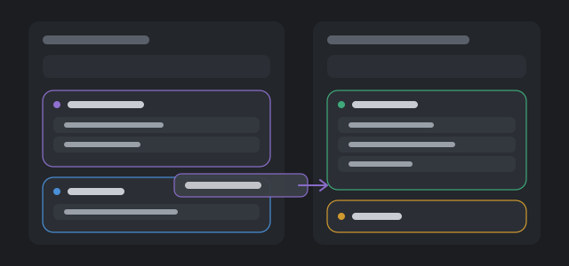

# dsh-workspace-categories

把 **the agent runtime** 桌面端侧边栏的**工作区**归入自定义**分类**。
每个分类是一个圆角矩形框，里面放着归入它的工作区和各自的会话；
长按标题即可拖动归类与排序。

[](LICENSE)




## 功能

- **分类即圆角框** —— 把相关的工作区放在一起。
- **长按拖动** —— 按住工作区标题片刻，拖进任意分类。
- **框内自由排序** —— 同一个手势拖动即可改变工作区在框内的位置。
- **分类排序与置顶** —— 拖分类标题，或用菜单的上移/下移；置顶的分类始终排最前。
- **七种颜色**、重命名、删除（带确认）。
- **两级都能收起** —— 收起整个分类，或只收起某个工作区的会话。
- **不会丢东西** —— 没有归类的工作区进「未分类」框，没有归属工作区的会话进「其他会话」框。
- **保留内置能力** —— 搜索（自动展开收起中的分类）、归档筛选、平铺视图、
  新建/重命名/删除工作区，以及完整的会话右键菜单。
- **持久化** —— 分类存在 Host 侧而非浏览器存储，重启和端口变化都不会丢。

## 环境要求

- DSH 桌面端 `>= 0.2.0-rc.2`。开发与验证于 `0.2.2-rc.3`。

## 安装

1. 克隆或下载本仓库。
2. 在 DSH 打开 **设置 → 插件 → 添加插件**，选择本仓库目录。

> 本地安装是**链接**而非拷贝。替换 `client.js` 后需要先移除再重新添加插件，
> DSH 不会热替换已加载的模块。

## 使用

| 操作 | 方式 |
|---|---|
| 新建分类 | 侧边栏「工作区」标题旁的 **＋** |
| 归类工作区 | **长按**工作区标题拖进目标框；或其 **⋯** 菜单 → *移到分类* |
| 框内排序 | 长按后落在另一行的上/下半部；框尾有插入线提示 |
| 调整分类顺序 | 长按分类标题，或分类 **⋯** 菜单 → *上移* / *下移* |
| 置顶分类 | 分类 **⋯** 菜单 → *置顶分类* |
| 改颜色 | 分类 **⋯** 菜单 → 七种配色 |
| 收起/展开分类 | 分类标题左侧三角 |
| 收起/展开工作区 | 工作区行左侧三角，或其 **⋯** 菜单 → *收起工作区* |
| 移出分类 | 拖进「未分类」框，或 **⋯** 菜单 → *移出分类* |
| 删除分类 | 分类 **⋯** 菜单 → *删除分类*（工作区回到「未分类」，不删会话） |
| 搜索/筛选/平铺 | 搜索框与右侧滑杆按钮 |

每个只能拖动的操作都另有菜单入口，键盘和触屏用户也能完成全部操作。

### 手势细节

- 按住 **180 ms** 开始拖动；先移动超过 6 px 则视为滚动或点击。
- 拖动中按 `Esc` 取消；窗口失焦或指针中断也会干净结束，不会残留幽灵框或锁住文本选择。
- 落到框与框之间或空白处**不是**有效落点，不会改变任何东西；只有「未分类」框会移出分类。
- 落在自己那一行上是无操作，不会跳到末尾。
- 置顶组与未置顶组不互相穿插，跨组拖动会被拒绝而不是静默丢弃。

## 数据

分类存成一个 JSON 文档，由 Host 半部分通过认证路由
（`/api/workspace-categories.doc`，仅 owner peer 可访问）读写：

```text
<DSH_HOME>/plugin-data/dsh-workspace-categories/categories.json
```

写入去抖 240 ms，经临时文件 + rename 串行落盘。保存失败会在面板提示并每 5 秒重试，
成功后提示自动消失。

```json
{
  "version": 1,
  "categories": [
    { "id": "c1", "name": "客户项目", "color": "blue",
      "pinned": true, "collapsed": false, "workspaceIds": ["w1", "w2"] }
  ],
  "view": { "mode": "categories", "archived": "default" },
  "unassignedCollapsed": false,
  "collapsedWorkspaces": ["w3"]
}
```

`color` 取 `brand | blue | green | amber | violet | rose | slate`；
`view.mode` 取 `categories | flat`；`view.archived` 取 `default | show | only`；
`collapsedWorkspaces` 是已收起的工作区 id 列表。
Host 会修复损坏或敌意的输入，坏文件不会让侧边栏打不开。

## 实现要点

- `sidebar.workspaces` 是 `single` 槽位。本插件以 `priority: -1000` 注册，
  槽位保留最低优先级，因此**替换**内置浏览器而不是并存。
- 侧边栏滚动区声明了 `container-type`，`position: fixed` 会相对侧边栏解析，
  所以菜单、对话框、拖动幽灵框都 portal 到 `document.body`。
- 会话行通过共享的 `useContextMenu` 触发内置会话菜单；内置的重命名/归档弹窗
  位于 `shell.overlay`，不受本次替换影响。
- 颜色与表面全部使用主题 token（`--dsw-alias-*`、`--dsw-radius-*`），深浅主题自适应。

## 已知限制

- 一个工作区只能属于**一个**分类；分类不能嵌套。
- 只替换工作区浏览区。会话行原有的 hover 置顶/归档按钮随之消失，
  这两个动作在会话右键菜单里仍然可用。
- 数据按机器与 profile 存储，无同步。

## 开发

见 [CONTRIBUTING.md](CONTRIBUTING.md)。验证脚本在 `tools/`：

```sh
node tools/check-keys.js client.js
node tools/test-gestures.cjs client.js
node tools/test-regressions.cjs client.js
node tools/test-host.mjs
```

## 许可证

[MIT](LICENSE) © 2026 Znk1314
