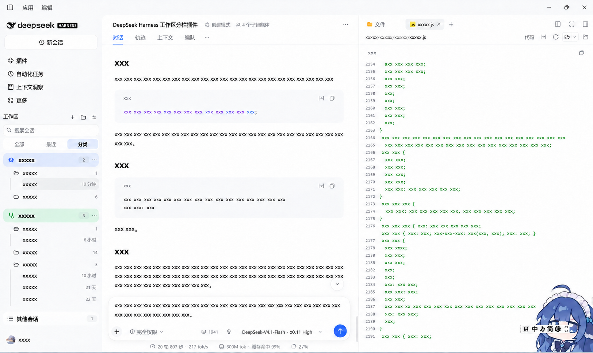

# dsh-workspace-categories

[English](README.md) · **简体中文**

> **还在为繁杂不堪的工作区而烦恼吗？**
> **还在为每次都需要下滑好久才能找到会话而烦恼吗？**

本插件来解决。把工作区归入自定义分类，再也不用翻半天找会话——
**全部 / 最近 / 分类**三种视图、每一级都能收起、长按拖动即可归类。

做这个插件就是因为这确实是我的痛点，我相信也是很多 DSH 用户的痛点。

[](https://github.com/Znk1314/dsh-workspace-categories/actions/workflows/tests.yml)
[](LICENSE)




## 为什么不直接用内置列表？

内置侧边栏是一条平铺的工作区列表。五个工作区时还好，五十个就没法用了：
每个工作区都会把所有会话展开显示，列表无限变长，想找东西只能一路往下滚。

本插件用的是同一份数据，改变的是**你怎么找到它**：

| | 内置 | 本插件 |
|---|---|---|
| 分组 | 无，只有一条平铺列表 | 自定义分类，可置顶、可排序 |
| 找会话 | 滚完整个列表 | **全部**（平铺会话）、**最近**（最近使用），或收起分类 |
| 视觉负担 | 每个工作区全部展开 | 分类和工作区**两级**都能收起 |
| 长列表 | 一路滚过去 | 会话挂在对应工作区下，只占一层缩进 |

而且什么都没删：搜索、归档筛选、新建/重命名/删除工作区、完整的会话右键菜单，全都还在。

## 环境要求

- DeepSeek Harness 桌面端 `>= 0.2.0-rc.2`。开发与验证于 `0.2.2-rc.3`。
- 无需构建、无需联网、无额外依赖，插件就是纯 JavaScript 加一个清单文件。

## 安装

插件是一个本地 **bundle**：DSH 把目录链接进当前 profile，而不是复制。

### 从插件页安装（推荐）

1. 取得文件。可以 `git clone https://github.com/Znk1314/dsh-workspace-categories.git`，
   或在仓库页点 **Code → Download ZIP** 后解压。
2. 在 DSH 打开 **设置 → 插件 → 添加插件**。
3. 选择**仓库根目录** —— 也就是含 `package.json` 和 `cordis.patch.yml` 的那一层，
   不要选它的上级目录，也不要选单个文件。
4. 插件列表出现 **Workspace categories** 条目，确认它是启用状态，侧边栏会立即更新。

### 确认是否生效

打开侧边栏，应能看到「工作区」标题、搜索框下方的 **全部 / 最近 / 分类** 标签，
以及标题旁的 **＋** 按钮（用来创建第一个分类）。

如果侧边栏没有任何变化，说明插件没有激活。先到 **设置 → 插件** 确认条目存在且已启用，
然后刷新窗口。**渲染时抛错的插件会静默回退到内置侧边栏**，所以「已启用但坏了」
看起来和「没装」完全一样。

### 更新

替换 `client.js`（或拉取新版本）之后，需要**先移除再重新添加**插件。
本地安装是链接，DSH 不会热替换已加载的客户端模块。分类数据存在 Host 侧，重装不会丢。

### 卸载

在 **设置 → 插件** 里移除即可。数据保留在
`<DSH_HOME>/plugin-data/dsh-workspace-categories/categories.json`，想一并清除就删掉该文件。
本插件从不删除任何会话、工作区或消息。

## 功能

- **圆角淡色分类行** —— 只有分类自己那一行是圆角矩形淡色背景，内含图标、名称和数量；其工作区与会话挂在下方普通底色上，由缩进线相连。
- **三种筛选** —— *全部*（一条平铺会话流）、*最近*（最近使用的工作区）、*分类*（你的分组）。选中的筛选是淡色圆角块。
- **点图标即收起** —— 点分类图标收起整个分类，点工作区文件夹只收起该工作区（收起时是闭合文件夹，展开时是打开的文件夹）。
- **运行状态可见** —— 正在运行的会话会把时间戳换成转圈动画。
- **长按拖动** —— 按住工作区标题片刻，拖进任意分类。
- **框内自由排序** —— 同一个手势拖动即可改变工作区在框内的位置。
- **分类排序与置顶** —— 拖分类标题，或用菜单的上移/下移；置顶的分类始终排最前。
- **图标与颜色自选** —— 每个分类可从 30 个线性图标和 9 种颜色中点选，选择器实时预览。颜色只染分类行与图标，文字始终用主题墨色。
- **两级都能收起** —— 收起整个分类，或只收起某个工作区的会话。
- **不会丢东西** —— 没有归类的工作区进「未分类」框，没有归属工作区的会话进「其他会话」框。
- **保留内置能力** —— 搜索（自动展开收起中的分类）、归档筛选、平铺视图、
  新建/重命名/删除工作区，以及完整的会话右键菜单。
- **持久化** —— 分类存在 Host 侧而非浏览器存储，重启和端口变化都不会丢。

## 使用

| 操作 | 方式 |
|---|---|
| 新建分类 | 侧边栏「工作区」标题旁的 **＋** |
| 在某个分类里直接新建工作区 | 鼠标移到分类行，点它右侧的 **＋** —— 创建和归类一步完成 |
| 归类工作区 | **长按**工作区标题拖进目标框；或其 **⋯** 菜单 → *移到分类* |
| 框内排序 | 长按后落在另一行的上/下半部；框尾有插入线提示 |
| 调整分类顺序 | 长按分类标题，或分类 **⋯** 菜单 → *上移* / *下移* |
| 置顶分类 | 分类 **⋯** 菜单 → *置顶分类* |
| 改图标或颜色 | 分类 **⋯** 菜单 → *图标与颜色*，再点选图标和色块 |
| 收起/展开分类 | 点分类图标；展开时图标为打开状态，收起时隐藏其工作区 |
| 收起/展开工作区 | 点它的文件夹图标（打开=展开，闭合=收起），或其 **⋯** 菜单 → *收起工作区* |
| 移出分类 | 拖进「未分类」框，或 **⋯** 菜单 → *移出分类* |
| 删除分类 | 分类 **⋯** 菜单 → *删除分类*（工作区回到「未分类」，不删会话） |
| 切换视图 | 搜索框下方的 **全部 / 最近 / 分类** 标签 |
| 归档筛选 | 右侧滑杆按钮 |

每个只能拖动的操作都另有菜单入口，键盘和触屏用户也能完成全部操作。

### 手势细节

- 按住 **180 ms** 开始拖动；先移动超过 6 px 则视为滚动或点击。
- 拖动中按 `Esc` 取消；窗口失焦或指针中断也会干净结束，不会残留幽灵框或锁住文本选择。
- 落到框与框之间或空白处**不是**有效落点，不会改变任何东西；只有「未分类」框会移出分类。
- 落在自己那一行上是无操作，不会跳到末尾。
- 置顶组与未置顶组不互相穿插，跨组拖动会被拒绝而不是静默丢弃。

## 数据

分类存成一个 JSON 文档，由 Host 半部分通过认证路由
（`/api/workspace-categories.doc`，仅 owner peer 可访问）读写：

```text
<DSH_HOME>/plugin-data/dsh-workspace-categories/categories.json
```

写入去抖 240 ms，经临时文件 + rename 串行落盘。保存失败会在面板提示并每 5 秒重试，
成功后提示自动消失。

```json
{
  "version": 1,
  "categories": [
    { "id": "c1", "name": "客户项目", "color": "blue", "icon": "briefcase",
      "pinned": true, "collapsed": false, "workspaceIds": ["w1", "w2"] }
  ],
  "view": { "tab": "categories", "archived": "default" },
  "unassignedCollapsed": false,
  "collapsedWorkspaces": ["w3"]
}
```

`color` 取 `ink | red | orange | amber | green | blue | violet | pink | slate`；
`view.tab` 取 `categories | recent | all`；`view.archived` 取 `default | show | only`；
`collapsedWorkspaces` 是已收起的工作区 id 列表；`icon` 取 30 个内置图标之一
（`folder`、`book`、`graduation`、`briefcase`、`terminal`、`palette`、`brain`、`plant` 等），未知值回退为 `folder`。
Host 会修复损坏或敌意的输入，坏文件不会让侧边栏打不开。

## 实现要点

- `sidebar.workspaces` 是 `single` 槽位。本插件以 `priority: -1000` 注册，
  槽位保留最低优先级，因此**替换**内置浏览器而不是并存。
- 侧边栏滚动区声明了 `container-type`，`position: fixed` 会相对侧边栏解析，
  所以菜单、对话框、拖动幽灵框都 portal 到 `document.body`。
- 会话行通过共享的 `useContextMenu` 触发内置会话菜单；内置的重命名/归档弹窗
  位于 `shell.overlay`，不受本次替换影响。
- 颜色与表面全部使用主题 token（`--dsw-alias-*`、`--dsw-radius-*`），深浅主题自适应。

## 与其他侧边栏插件的兼容性

DSH 的侧边栏浏览区（`sidebar.workspaces`）是一个**单占位（single）**槽位：只有一个条目会渲染。
这是框架的设计，不是本插件的选择，它带来两个安装前应当知道的后果。

### 同一时间只能有一个侧边栏插件

任何同样接管浏览区的插件——另一种分组界面、标签式侧边栏、替换式会话列表——都在争夺同一个座位。
最终只有一个会渲染，其余完全不生效，而且**不会有任何冲突提示**。
如果侧边栏不是预期的样子，请停用其中一个再刷新。

本插件以**负值**的遮蔽优先级注册（低于内置浏览器隐含的 0），这才是它拿下这个座位的原因。
如果你 fork 后删掉这个值，内置浏览器会重新接管侧边栏——插件看起来像没装，其实已经加载了。

### 挂在会话行内部的扩展仍然有效

浏览区声明了若干子槽位供其他插件挂载。替换浏览区的插件必须自己转发这些槽位，
否则挂在上面的扩展会**静默消失**。本插件转发了全部三个：

| 槽位 | 渲染位置 |
|---|---|
| `sidebar.session.row.leading` | 会话标题之前 |
| `sidebar.session.row.trailing` | 标题之后、时间戳之前 |
| `sidebar.workspaces.session.row.action` | 行末操作区 |

每个槽位都会带上官方浏览器传入的 `sessionId`（操作区还带 `displayTitle`），
扩展无法分辨差异。没有扩展挂载时不会产生多余 DOM；某个槽位抛错时会被跳过，而不会拖垮整个侧边栏。

### 已知缺口

官方浏览器提供的另外两个槽位**未转发**，因为本插件不构建它们所属的界面：

- `sidebar.session.row.hover` —— 这里没有会话 hover 卡片。
- `sidebar.workspaces.directoryFlow` —— 这里没有目录流步骤。

针对这两个槽位的扩展不会渲染。会话右键菜单（`contextMenu`）的全部内容不受影响，照常工作。

## 已知限制

- 一个工作区只能属于**一个**分类；分类不能嵌套。
- 只替换工作区浏览区。会话行原有的 hover 置顶/归档按钮随之消失，
  这两个动作在会话右键菜单里仍然可用。
- 数据按机器与 profile 存储，无同步。

## 开发

见 [CONTRIBUTING.md](CONTRIBUTING.md)。验证脚本在 `tools/`：

```sh
node tools/check-keys.js client.js
node tools/test-gestures.cjs client.js
node tools/test-regressions.cjs client.js
node tools/test-host.mjs
```

## 许可证

[MIT](LICENSE) © 2026 Znk1314
